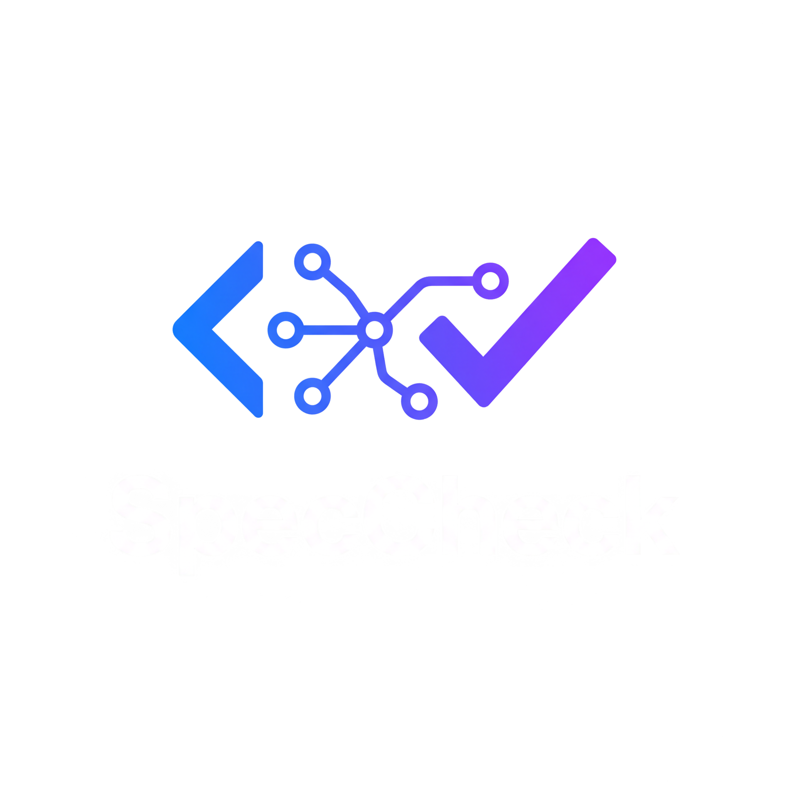

<div align="center">
  
  <h1>SpecCheck</h1>
  <p>
    <strong>Verifica automatizzata della tracciabilità end-to-end da Casi d'Uso a Requisiti e Codice Sorgente per OpenCode</strong>
  </p>
  <p>
    <em>Progetto di Ingegneria del Software (A.A. 2026/2027) — Università degli Studi di Padova</em><br />
    <em>Capitolato C9 proposto da Zucchetti S.p.A.</em>
  </p>
</div>

---

## Panoramica del progetto

Con la diffusione dello sviluppo assistito da Large Language Models (*agentic coding*), la generazione del codice sorgente ha raggiunto velocità elevate, spostando il vero collo di bottiglia dalla scrittura alla **verifica** della correttezza semantica e funzionale rispetto alle specifiche iniziali.

**SpecCheck** nasce per colmare questo divario estendendo l'agente di *harness* **OpenCode** con un sistema integrato di controllo della tracciabilità end-to-end. Il sistema non si occupa di generare codice applicativo, bensì di validare in modo strutturato che:
1. Ogni **caso d'uso** raccolto in fase di analisi trovi effettiva corrispondenza nelle **specifiche dei requisiti**.
2. Il **codice sorgente** implementi fedelmente il comportamento definito dai **requisiti** e dai **casi d'uso** di partenza.

---

## Funzionalità principali

* **Analisi dei Casi d'Uso:** acquisizione dei diagrammi dei casi d'uso (formati testuali/strutturati come Mermaid o XMI e relative immagini) e della documentazione descrittiva associata.
* **Allineamento Casi d'Uso → Requisiti:** confronto semantico tra casi d'uso e specifiche dei requisiti per verificare la copertura completa e segnalare eventuali incongruenze o omissioni.
* **Verifica Requisiti → Codice Sorgente:** ispezione del comportamento del programma a partire dal codice sorgente e confronto con quanto prescritto dalle specifiche formali.
* **Dashboard di Tracciabilità e Discrepanze:** reportistica sullo stato di avanzamento dell'implementazione (tramite interfaccia TUI su terminale ed eventuale vista grafica HTML) con evidenza immediata delle discrepanze rilevate.
* **Installazione Unificata:** distribuzione del pacchetto come prodotto unico installabile tramite script dedicato (`bash` / `PowerShell`).

---

## Architettura

SpecCheck estende **OpenCode** combinando componenti dichiarativi e strumenti deterministici:

| Componente | Ruolo nel sistema |
| :--- | :--- |
| **Skills** | Definiscono i workflow di analisi, confronto semantico e validazione tra artefatti (casi d'uso, specifiche e codice). |
| **Tools** | Forniscono capacità operative per il parsing strutturato dei file di progetto, dei diagrammi e dei sorgenti. |
| **Commands** | Espongono comandi rapidi invocabili dall'utente all'interno dell'ambiente OpenCode. |
| **Plug-in / Dashboard** | Elabora in modo deterministico lo stato della tracciabilità e presenta il riepilogo delle discrepanze. |

---

## Struttura della repository

```text
SpecCheck/
├── Assets/          # Risorse grafiche e logo del progetto
├── skills/          # Definizione delle Skill per OpenCode
├── tools/           # Tool di supporto al parsing e all'analisi
├── commands/        # Comandi personalizzati per OpenCode
├── plugin/          # Plug-in per la dashboard di tracciabilità
├── scripts/         # Script di installazione unificata (Bash / PowerShell)
├── tests/           # Suite di test automatici
└── docs/            # Manuale utente e guida all'estensione
